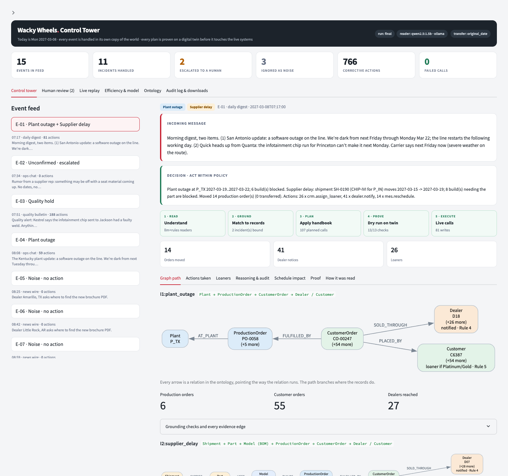
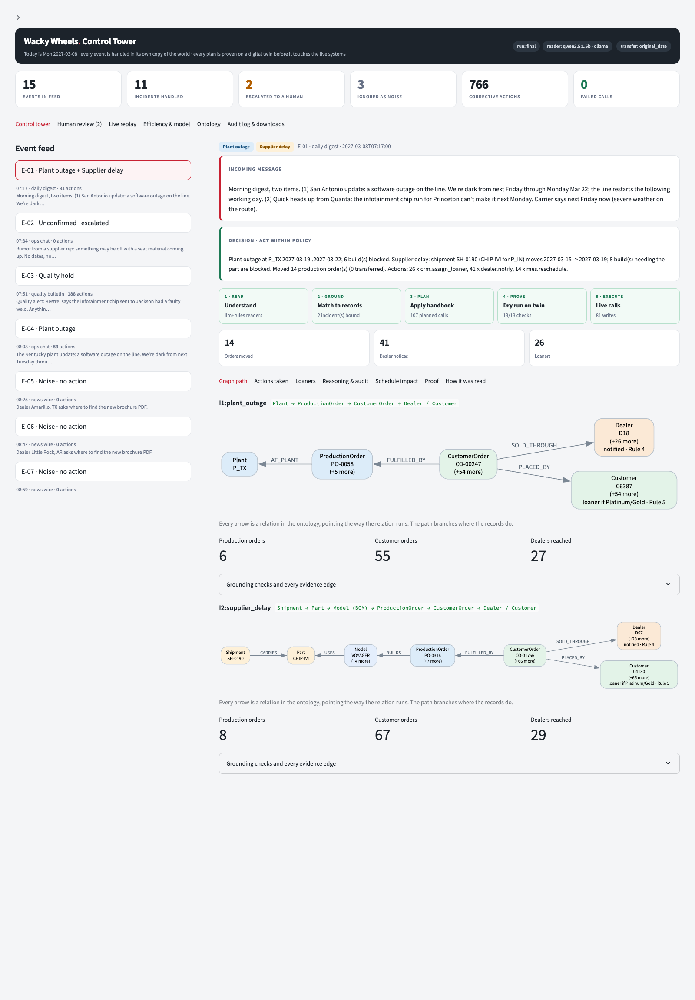
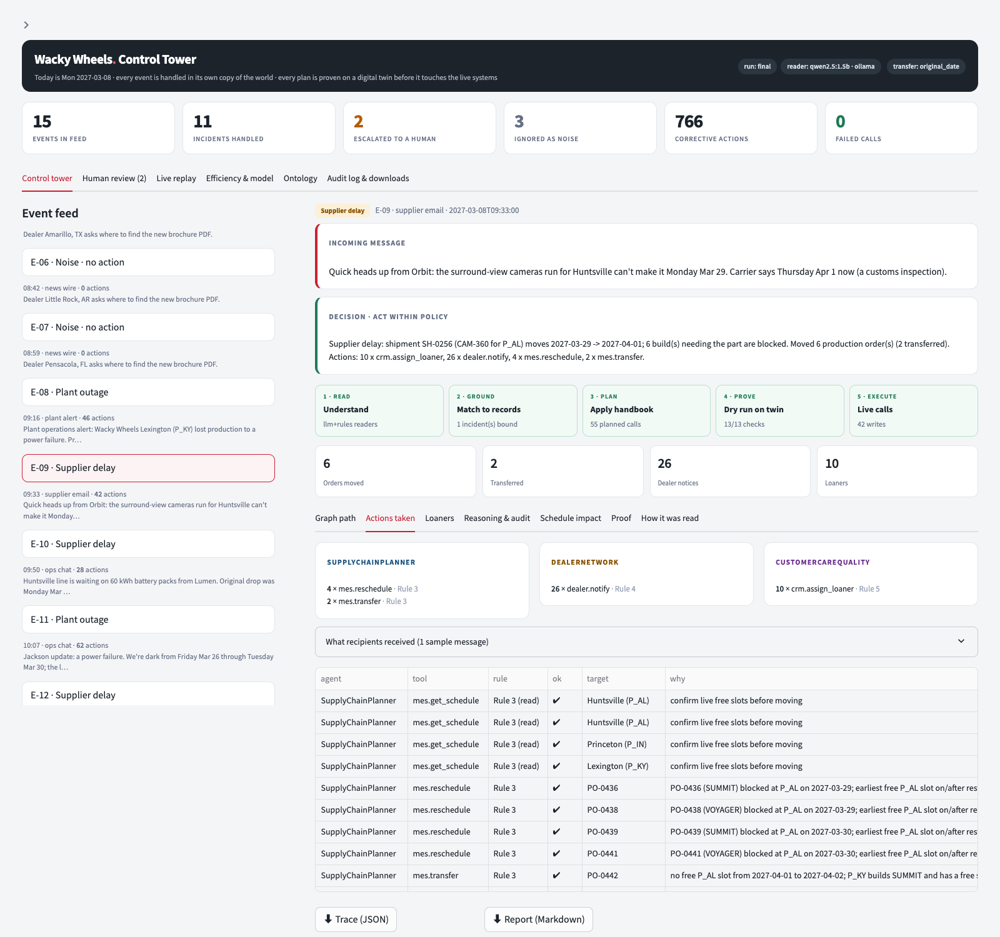
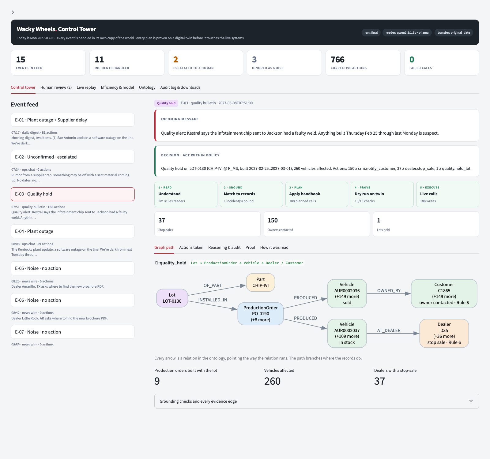
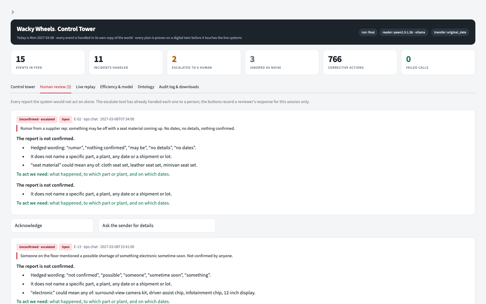

# Wacky Wheels Control Tower

A just-in-time automaker keeps no parts inventory, so a late shipment, a plant outage or a defective part lot quickly reaches production schedules, dealers, loaner cars and owners. This control tower reads a feed of operational events, finds everything each event touches through a knowledge graph, and carries out the corrective actions through the enterprise tools, following the policy handbook. A coordinator and three specialist agents do the work, and every plan is proven on a copy of the systems before it runs.

**Live demo:** [wacky-wheels-control-tower.streamlit.app](https://wacky-wheels-control-tower.streamlit.app/)



## What it does

| Event type | What the system does |
|---|---|
| Supplier delay | Moves the builds that need the part, notifies each affected dealer once, assigns loaners |
| Plant outage | Reschedules or transfers orders within plant capacity, notifies dealers, assigns loaners |
| Quality hold | Holds the lot, stops sale of unsold vehicles, contacts owners of sold vehicles |
| Noise | No action |
| Unconfirmed report | Escalates to a human, no operational change |
| Compound message | Splits it and handles each incident, sharing one slot and loaner ledger |

## How it works

1. **Read.** A small local LLM and a rule-based reader each interpret the message. The LLM returns only the incident kind and the names and date phrases as written. Code maps names to ids and phrases to dates.
2. **Ground.** The knowledge graph decides which reading is real. A reading counts only if it binds to existing records. One binding acts, a conflict or a vague report escalates, and a message with no operational entity is noise.
3. **Compile.** The policy handbook is applied as code, split across a coordinator and three specialists:
   - `SupplyChainPlanner`: reads schedules, reschedules or transfers production orders.
   - `DealerNetwork`: one notice per dealer, stop-sale of unsold vehicles.
   - `CustomerCareQuality`: loaner checks and assignment, owner notices, lot holds.
4. **Prove.** The plan is dry-run on a local copy of the enterprise systems and checked against 13 invariants. A failing check withholds the plan and escalates.
5. **Execute and explain.** Calls go to the enterprise server. Each event writes a trace with the graph path, plan, proof, executed calls and audit trail.

The ontology has 11 classes (Supplier, Part, Model, Plant, Shipment, Lot, ProductionOrder, CustomerOrder, Customer, Dealer, Vehicle) and 17 relations, one of them inferred (`Lot -INSTALLED_IN-> ProductionOrder`). The built graph has about 17,000 nodes and 28,000 edges. [DESIGN_CARD.md](DESIGN_CARD.md) describes the design on one page.

## Model

`qwen2.5:1.5b` (Qwen2.5 1.5B Instruct) served locally by Ollama. The recorded run made 15 LLM calls, 6,423 tokens, 27.8 s of model time (28.9 s end to end). No cloud service is used.

## Results

The recorded run in `runs/final` covers 15 events: 1 compound, 3 supplier delays, 3 plant outages, 3 quality holds, 3 noise and 2 unconfirmed reports.

| | |
|---|---|
| Tool calls in `action_log.jsonl` | 879, of which 0 failed |
| Write actions | 766 |
| Escalations | 2 (the unconfirmed reports) |
| Writes on noise or unconfirmed reports | 0 |
| Replay on a fresh world | all events pass |
| Independent audit (`tools/audit_run.py`) | all handbook rules hold |
| Tests | 31 pass |

The log has one line per tool call, each tagged with its `event_id`. The three noise events make no calls, so 12 of the 15 events appear in it.

## Screenshots

| Graph path for a compound event | Actions by agent for a supplier delay |
|---|---|
|  |  |
| **Quality hold: lot to vehicles to dealers and owners** | **Unconfirmed reports escalated to a human** |
|  |  |

The rest are in [`screenshots/`](screenshots): audit trail, noise, live replay, efficiency and model, ontology and audit log.

## Run the UI and the checks

Python 3.11 or newer.

```bash
pip install -r requirements.txt

streamlit run control_tower/app.py              # control-tower UI (opens runs/final)
python -m pytest tests -q                       # tests
python -m control_tower.replay runs/final       # replay the recorded log on a fresh world
python tools/audit_run.py runs/final            # independent rule audit
```

## Run the agents

Start the enterprise server once per run, in one terminal:

```bash
python enterprise_server.py --data data --events data/events.json --out runs/new --port 8000
```

Then run the agents in a second terminal:

```bash
python -m control_tower.run --server http://127.0.0.1:8000 --out runs/new
```

To use the LLM reader, install [Ollama](https://ollama.com), then:

```bash
ollama pull qwen2.5:1.5b
CT_LLM=ollama CT_LLM_MODEL=qwen2.5:1.5b python -m control_tower.run --server http://127.0.0.1:8000 --out runs/new
```

Without `CT_LLM` the rule reader runs alone. `python -m control_tower.run --twin --out runs/offline` runs against the local copy with no server. Any OpenAI-compatible local server also works: set `CT_LLM=openai`, `CT_LLM_URL` and `CT_LLM_MODEL`. To rebuild the readable reports for a run: `python tools/export_reports.py runs/new`.

## Repository layout

| Path | Contents |
|---|---|
| `control_tower/` | Agents, knowledge graph, grounding, impact traversals, pipeline, verifier and the UI |
| `tools/` | `audit_run.py` (independent audit) and `export_reports.py` (reports and ontology SVG) |
| `tests/` | 31 tests |
| `data/` | Company tables, `policy_handbook.md` and `events.json` |
| `enterprise.py` | Mock enterprise systems: MES, dealer portal, CRM, quality |
| `enterprise_server.py` | Local HTTP server for those systems |
| `runs/final/` | The recorded run (below) |
| `screenshots/` | The control-tower UI |

`runs/final/` contains:

| File | Content |
|---|---|
| `action_log.jsonl` | Every tool call, written by the server |
| `traces/E-01.json` to `E-15.json` | Per event: readings, grounding, graph path and evidence edges, plan, dry-run proof, executed calls, audit trail, summary |
| `reports/E-01.md` to `E-15.md` | The same trace as a readable page, with the reason for what was done or not done |
| `reports/ontology.svg` | Ontology diagram |
| `ontology/ontology.json`, `ontology.mmd` | Ontology export (JSON and Mermaid) |
| `run_summary.json` | Per-event call counts, model, tokens and timings |

## Assumptions

The handbook does not say where a transferred order lands, or how to order orders when slots are scarce. Transfers keep the order's original build date (`CT_TRANSFER_ANCHOR=original_date`; the alternatives are `disruption_start`, `today` and `restart`). Scarce slots go to orders in order of original build date, then order id. A phrase like "next Friday" means that day next week unless the data says otherwise.
